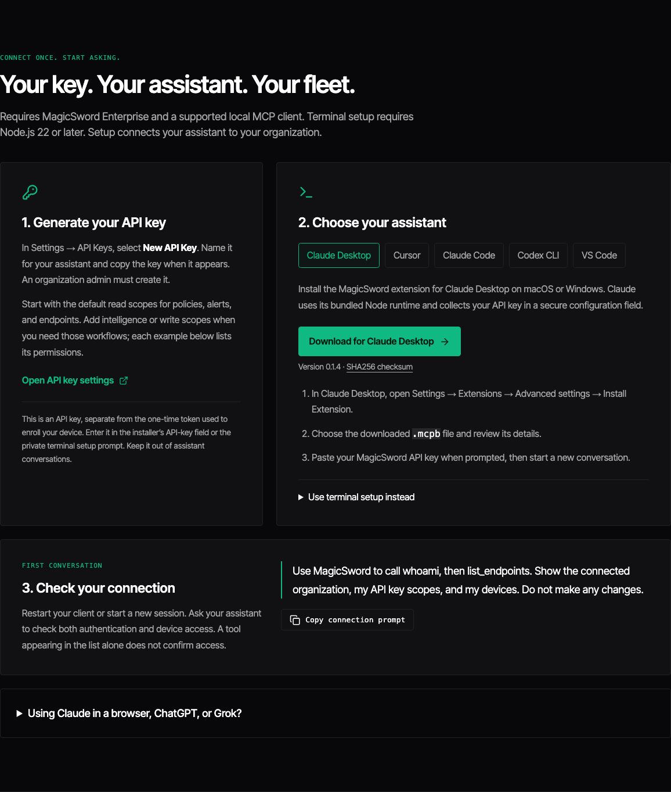
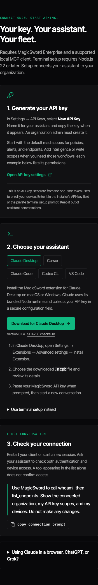

# Client setup contract

Setup is complete when the selected client can launch the installed server and
the server can discover its tools and make authorized read-only production calls.

- SETUP-01: Configure defaults to `https://www.magicsword.io` even when an older
  credential file contains a preview origin. Custom origins require `--base-url`.
  Setup never displays the old origin or any portion of a saved API key.
- SETUP-02: Interactive API-key entry is hidden. Credentials stay in the private
  MagicSword file, never in a client configuration or printed snippet.
- SETUP-03: Interactive setup asks for a client. Explicit `--client` supports
  Claude Desktop, Codex, Claude Code, Cursor, and manual setup. Unattended setup
  without a client writes only MagicSword's own configuration.
- SETUP-04: Registration uses absolute Node and server paths, independent of a
  desktop app's PATH. Existing unrelated settings survive registration. Invalid
  client configuration is rejected without overwriting it. Existing client files
  receive private backups. JSON clients allow an explicit configuration path;
  CLI clients use their official user-level registration commands.
- SETUP-05: Tests cover production migration, credentials, preservation, invalid
  files, client dispatch, and a real packed installation. Local live evidence
  records only pass/fail and counts, never credentials or customer responses.
- SETUP-06: Public install buttons decode to credential-free production stdio
  entries for Cursor and VS Code/Insiders. One-liners and manual JSON fallbacks
  accompany them. Saving credentials is a separate prerequisite for buttons.

Assurance: A3 for credential handling and client registration. Independent review
and real stdio/read-only production evidence are required before release. GUI
activation requires the client to restart or begin a new session. Tests must not
claim desktop activation solely from a configuration write.

Client installation references:

- [Cursor install links](https://cursor.com/docs/mcp/install-links)
- [VS Code MCP developer guide](https://code.visualstudio.com/api/extension-guides/ai/mcp)
- [Microsoft's install-button examples](https://github.com/MicrosoftDocs/mcp)
- [Codex MCP configuration](https://developers.openai.com/codex/mcp/)
- [Claude Code MCP configuration](https://code.claude.com/docs/en/mcp)

Native Windows CLI registration and terminal hiding require separate Windows
verification. JSON/button and direct-CLI fallbacks remain available. No GUI
activation claim should be made from the macOS stdio checks alone.

## Installer guide screenshots

Captured from the portal's download guide using a synthetic GitHub release
fixture for version 0.1.4. These show the download UI after the installer and
checksum are published. They do not establish public release availability,
native Claude installation or directory approval. No API key is shown.

Desktop:

Mobile installer guide

See [deployment order](RELEASING.md#first-desktop-installer-release-deployment-order)
for the release sequence and publication checks.
